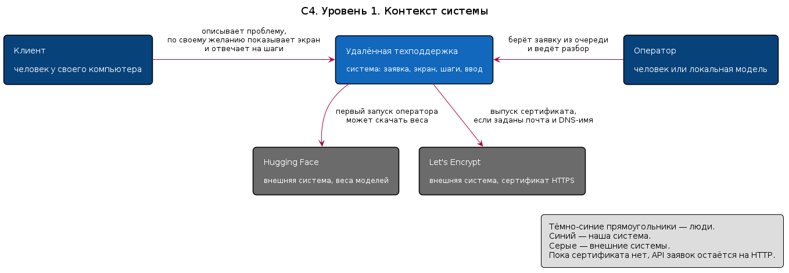
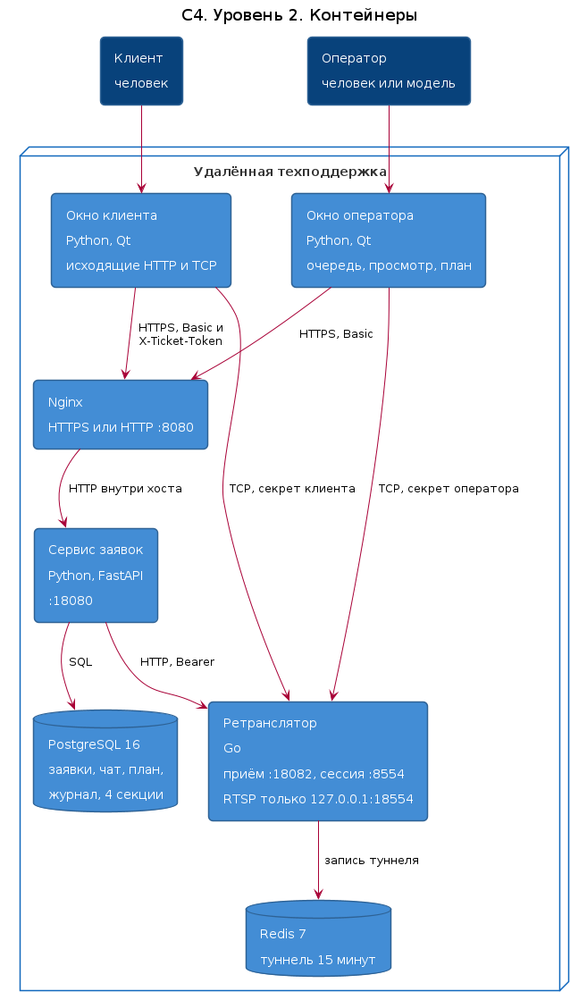
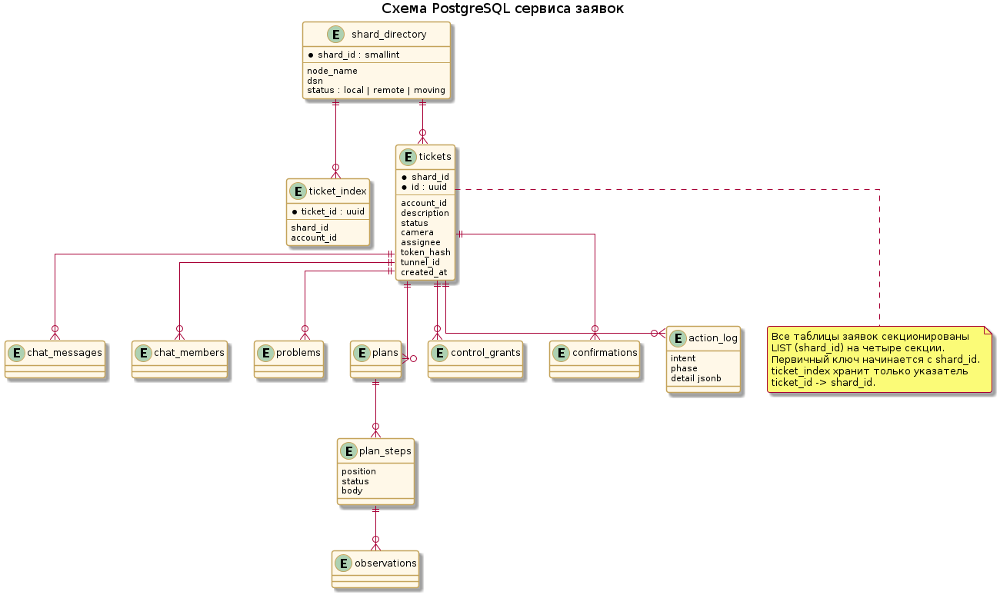
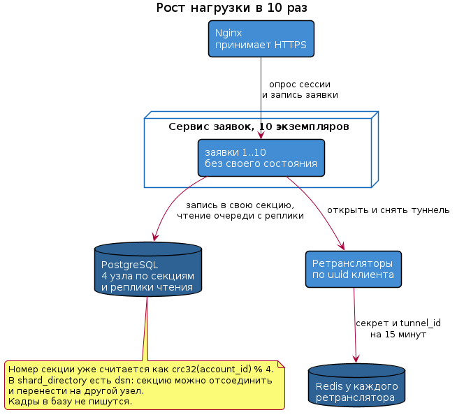

# Удалённая техподдержка

Отчёт по курсовому проекту. Код лежит в этом же репозитории. Сборка и запуск серверной части — `docker compose up -d --build`.

## <a id="uchastniki"></a>Участники

В истории git есть коммиты трёх логинов. ФИО и номера академических групп в репозитории не записаны: их нужно подставить в таблицу перед сдачей.

| Логин в git | Коммитов в текущей истории | ФИО | Группа |
| --- | --- | --- | --- |
| atroxxx | 6 |  |  |
| Aapng-cmd | 6 |  |  |
| Chebupele | 2 |  |  |

Репозиторий: https://github.com/atroxxxxxx/team-viewer.git

## <a id="problema"></a>Определение проблемы

Клиенту и оператору техподдержки трудно вместе разбирать неисправность на компьютере клиента: оператор не видит экран, пока клиент сам не покажет его, а пересказ в чате картинку не заменяет. Управление мышью и клавиатурой без явного согласия опасно, а без согласия клиенту не из чего собрать порядок действий. Если оператор пропал посреди разбора, заявка остаётся на нём, и клиент не видит, что его переключают на другого человека.

## <a id="trebovaniya"></a>Выработка требований

Ориентир нагрузки, не замер аудитории: **10 000 клиентов в сутки**. Записи заявок, чата, шагов и журнала хранятся **7 лет**. Кадры экрана не хранятся. Рабочий туннель в Redis живёт 15 минут.

Пользовательские истории:

1. **Когда** у меня сломалась программа, **я хочу** описать проблему и отдать экран только после того, как оператор взял заявку, **чтобы** не открывать входящий порт и не показывать рабочий стол всем подряд.
2. **Когда** оператор просит управление, **я хочу** разрешить мышь, клавиши и текст в явном scope или получить план шагов в том порядке, в котором его составили, **чтобы** запрещённая команда не исполнилась, а шаги не перепутались.
3. **Когда** проблема решена или не решена, **я хочу** закрыть заявку сам, а если оператор пропал, **я хочу** увидеть «Переключение на другого оператора» и чтобы заявка вернулась в очередь, **чтобы** разбор не зависал на отсутствующем человеке.

Диаграммы историй: [сессия](docs/uml/story-session.png), [управление и шаги](docs/uml/story-steps.png), [закрытие](docs/uml/story-close.png).

## <a id="nagruzka"></a>Характер нагрузки

Цифры ниже — расчёт от ориентира 10 000 заявок в сутки, средней длины сессии 10 минут и пика в 4 раза выше среднего. Это проектная оценка, не результат нагрузочного прогона.

Среднее число одновременных сессий: `10000 × 10 / 1440 ≈ 70`. На пике около **280 сессий**.

| Показатель | Оценка на пике |
| --- | --- |
| Чтения | Около 560 `GET /session` в секунду: клиент и оператор опрашивают сессию примерно раз в секунду |
| Записи | Около 10 запросов в секунду: создание, захват, чат, шаги, ввод, закрытие |
| Соотношение R/W | Примерно 60 чтений на 1 запись, то есть около 98 % чтений |
| Трафик API | Около 560 × 8 КБ ≈ 4,5 МБ/с |
| Трафик экрана | До 2 Мбит/с на поток. При 1 Мбит/с в среднем и 280 сессиях — около 280 Мбит/с к ретранслятору и столько же к операторам |
| Диск PostgreSQL | Около 64 КБ на заявку с индексами. 10 000 × 64 КБ ≈ 640 МБ/сутки, за 7 лет около **1,6 ТБ** |
| Диск Redis | Килобайты на туннель, TTL 15 минут. На пике порядка 1 МБ |
| Кадры | В базу и в Redis не пишутся |

## <a id="c4"></a>Архитектура

Первые два уровня [C4](https://c4model.com/): контекст и контейнеры. Исходники лежат рядом с картинками в [docs/uml](docs/uml).

### Контекст

Клиент и оператор работают с одной системой. Снаружи система ходит за весами моделей на Hugging Face, если оператор не запущен с `--no-models`, и за сертификатом в Let's Encrypt, если в `.env` заданы почта и DNS-имя.



### Контейнеры

Окна только исходящие. Nginx принимает HTTPS заявок. Сервис заявок хранит состояние в PostgreSQL и после захвата открывает туннель в ретрансляторе. Ретранслятор держит туннель в своём Redis и склеивает сессию на порту `8554`. RTSP наружу не публикуется.



| Контейнер | Стек | Что хранит |
| --- | --- | --- |
| Окно клиента и окно оператора | Python, Qt | Настройки без пароля и токена заявки |
| Nginx | nginx 1.27 | Не хранит заявки |
| Сервис заявок | Python, FastAPI, SQLAlchemy | Не хранит состояние процесса: всё в PostgreSQL |
| PostgreSQL 16 | один кластер, 4 секции | Заявки, чат, планы, гранты, журнал |
| Ретранслятор | Go | Не хранит заявку дольше TTL |
| Redis 7 | рядом с ретранслятором | uuid клиента, `tunnel_id`, секреты ролей, 15 минут |

## <a id="api"></a>Контракты API и время отклика

Контракт сервиса заявок — [ticket-service/openapi.json](ticket-service/openapi.json). Клиент после создания заявки передаёт `X-Ticket-Token`. Оператор работает с Basic-учёткой `operator`. Очередь не содержит uuid клиента и секретов сессии. Секрет своей роли возвращают захват и `GET /session` назначенного участника.

Ретранслятор, порт `18082`: `POST /api/v1/tunnels` и `DELETE /api/v1/tunnels/{ticket}` с `Authorization: Bearer`. Порт `8554`: первая строка `CLIENT <uuid> <секрет>` или `OPERATOR <uuid> <секрет>`.

Целевое время, 95-й перцентиль, при расчётном пике:

| Вызов | Цель |
| --- | --- |
| `GET /session`, очередь, чтение заявки | 200 мс |
| Создание заявки, чат, план, закрытие | 300 мс |
| `POST /claim` | 500 мс, внутри есть вызов ретранслятора |
| Первая строка на порту `8554` | 50 мс до склейки или отказа |
| Уже идущий поток через ретранслятор | 100 мс добавки к кадру |

На локальном стенде сессионный мост добавлял около 40 мс, а первый кадр целиком приходил примерно за 0,5 с. Это замер из [PROBLEMS.md](PROBLEMS.md), не обещание для 280 одновременных сессий.

## <a id="schema"></a>Схема базы и запас по требованиям



Заявка и все дочерние строки секционированы `LIST (shard_id)` на `s0`…`s3`. Номер секции — `crc32(account_id) % 4`. Первичный ключ начинается с `shard_id`, поэтому внешние ключи остаются внутри секции. `ticket_index` хранит только пару `ticket_id → shard_id`, не текст заявки. Очередь читается по индексу `(status, created_at)`. Шаг плана хранит `position`, список идёт в порядке отправки.

Запас относительно требований:

- 1,6 ТБ за 7 лет помещается на один узел PostgreSQL 16. Кадры в этот объём не входят.
- Пик 560 чтений сессии в секунду — чтение одной секции по первичному ключу и коротких дочерних строк, без обхода всей таблицы.
- Redis не участвует в сроке хранения 7 лет: ключ туннеля исчезает через 15 минут или по `DELETE`.
- Секреты сессии лежат в `action_log` конкретной заявки и не попадают в ответ очереди.

Исходная схема: [postgres-redis/init/001_schema.sql](postgres-redis/init/001_schema.sql).

## <a id="masshtab"></a>Рост нагрузки в 10 раз

При 100 000 заявок в сутки пик — около 2 800 сессий, около 5 600 чтений API в секунду и около 2,8 Гбит/с экрана в одну сторону. Диск за 7 лет — около 16 ТБ.



Сервис заявок состояния не держит, поэтому за nginx ставятся одинаковые экземпляры. Чтение сессии уходит на реплики PostgreSQL, запись — в первичную секцию. Четыре секции уже заложены: `shard_directory.dsn` и `DETACH PARTITION` переносят секцию на отдельный узел, когда 16 ТБ перестают помещаться на один диск. Ретрансляторы делятся по uuid клиента, у каждого свой Redis на 15 минут. Видео по-прежнему не сохраняется, поэтому рост числа сессий не умножает архив кадров.

## <a id="kod"></a>Кодирование и отладка

Сервер заявок — Python. Ретранслятор — Go. Окна — Python и Qt. Коммиты в репозитории есть у atroxxx, Aapng-cmd и Chebupele.

Сейчас в поставке работают: заявка и токен клиента, очередь без uuid клиента, захват с двумя секретами сессии, план в порядке отправки, ввод только после гранта и повторной проверки на клиенте, закрытие кнопками «Решено» и «Не решено», возврат заявки в очередь при закрытии окна оператора и при молчании панели 60 секунд. Выгрузка журнала в корпус обучения и сбор stdout в ELK в поставку не входят.

## <a id="unit"></a>Модульные тесты

Тесты проверяют правила и поведение модулей, а не арифметику.

| Модуль | Что проверяет |
| --- | --- |
| `support-protocol/tests/test_policy.py` | Запрет опасного шага и сочетания клавиш, текст с управляющим символом, код клавиши, координаты внутри кадра |
| `ticket-service/tests/test_rules.py` | Тот же запрет текста на стороне сервиса заявок |
| `support-protocol/tests/test_media.py` | Аргументы ffmpeg, частота кадров, адрес локального моста |
| `support-protocol/tests/test_settings.py` | Настройки не сохраняют пароль и токен, битый файл не затирает рабочие |
| `support-protocol/tests/test_api_errors.py` | Таймаут и ответ сервера не попадают в текст для человека |
| `support-protocol/tests/test_input_session.py` | Очередь ввода отменяется при завершении сеанса |
| `operator-app/tests/test_models.py` | Ответ модели режется до допустимого действия |
| `relay-service/internal/session/bridge_test.go` | Строка сессии без секрета отвергается, секрет одной роли не открывает другую |
| `scripts/tests/test_dev.py` | Локальный цикл разработки ticket-service |

Запуск модульных тестов протокола: `PYTHONPATH=support-protocol python3 -m pytest support-protocol/tests/test_policy.py support-protocol/tests/test_media.py support-protocol/tests/test_settings.py -q`. Тесты ретранслятора: `cd relay-service && go test ./internal/session/ ./internal/rtsp/`.

## <a id="integraciya"></a>Интеграционное тестирование

История «клиент создаёт заявку, оператор её захватывает, клиент закрывает сессию» покрыта `ticket-service/tests/test_api.py`. Тест поднимает отдельную схему PostgreSQL, не чистит чужие данные и гоняет HTTP сервиса заявок с заглушкой ретранслятора. В том же файле проверяются порядок шагов, секрет своей роли, закрытие клиентом при открытых шагах и возврат заявки в очередь, когда оператор ушёл.

Окна этой истории проверяет `support-protocol/tests/test_desktop.py` на Qt без экрана: клиент видит фразу переключения, оператор отпускает заявку, закрытие окна вызывает `POST /release`.

Интеграционные тесты заявок требуют `TEST_DATABASE_URL`. Пример запуска из каталога `ticket-service`: `PYTHONPATH=. python3 -m pytest tests/test_api.py -q`.

## <a id="sborka"></a>Сборка

Серверная часть собирается и запускается из корня:

```bash
docker compose up -d --build
```

Поднимаются PostgreSQL, Redis, сервис заявок, ретранслятор, разовый выпуск сертификата и nginx. Postgres и Redis на хост не публикуются. Заявки снаружи — `https://127.0.0.1`, если сертификат выпущен, иначе `http://127.0.0.1:8080`. Приём туннеля — порт `18082`. Сессия клиента и оператора — порт `8554`.

Окна ставятся отдельно, см. [client-app/README.md](client-app/README.md) и [operator-app/README.md](operator-app/README.md). Локальный цикл только сервиса заявок описан в [DEVELOPMENT.md](DEVELOPMENT.md).

Каталог диаграмм: [docs/README.md](docs/README.md).
