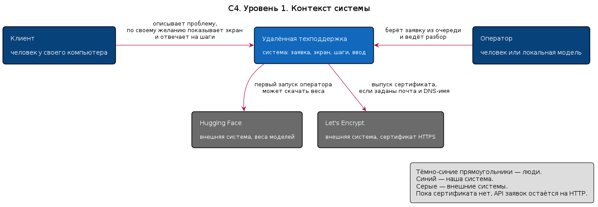
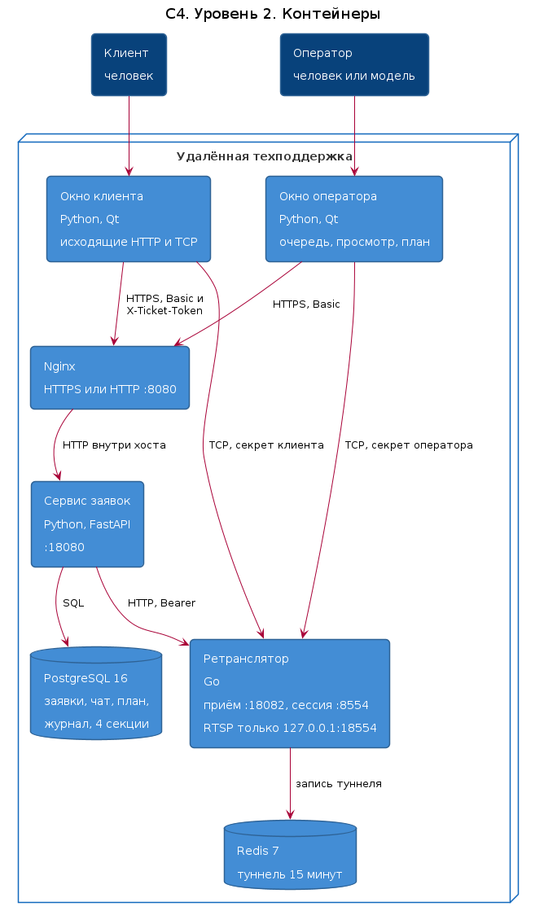
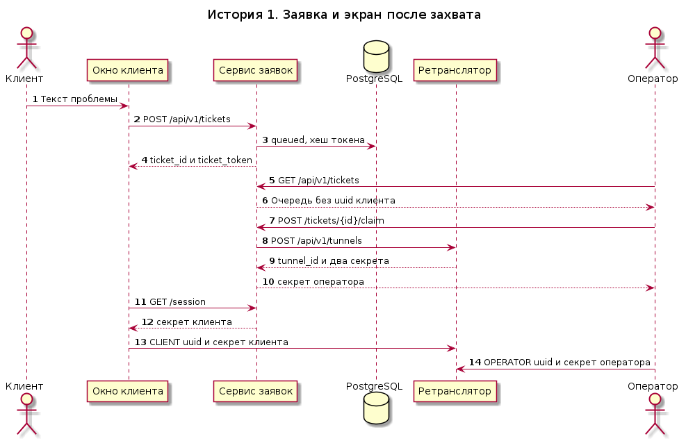
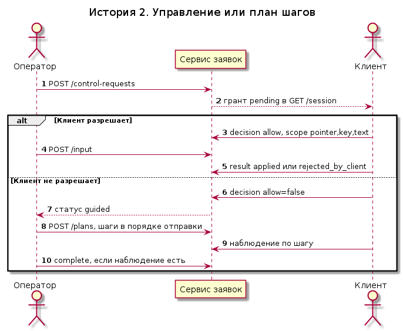
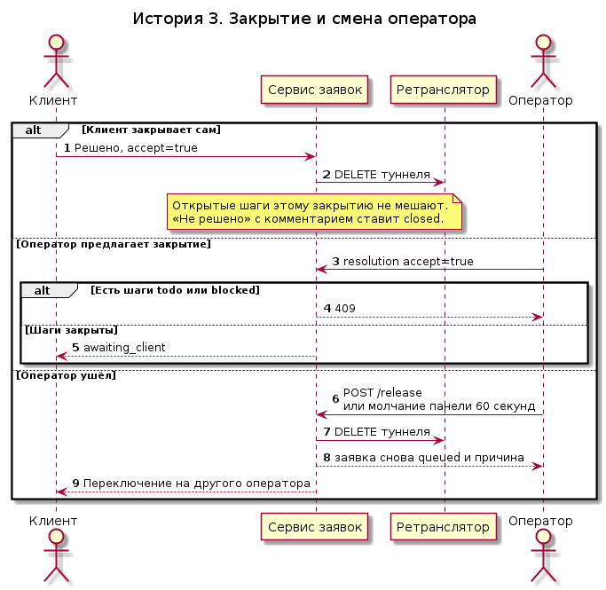
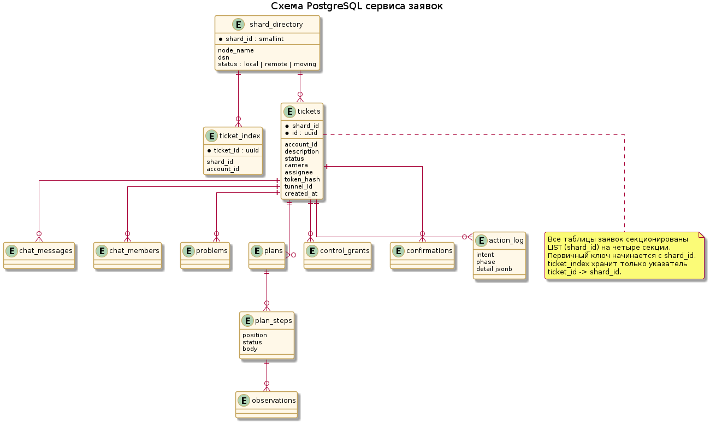
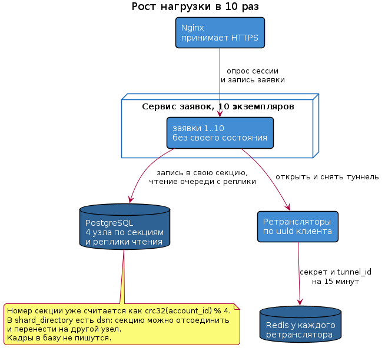

# Диаграммы отчёта

Текст отчёта — в корневом [README.md](../README.md). Здесь только картинки и исходники PlantUML. Сплошная связь на диаграммах — вызов, который есть в текущей поставке.

| Раздел отчёта | Картинка | Исходник |
| --- | --- | --- |
| [Контекст C4](../README.md#c4) | [png](uml/c4-context.png) | [puml](uml/c4-context.puml) |
| [Контейнеры C4](../README.md#c4) | [png](uml/c4-container.png) | [puml](uml/c4-container.puml) |
| [История: заявка и экран](../README.md#trebovaniya) | [png](uml/story-session.png) | [puml](uml/story-session.puml) |
| [История: управление и шаги](../README.md#trebovaniya) | [png](uml/story-steps.png) | [puml](uml/story-steps.puml) |
| [История: закрытие](../README.md#trebovaniya) | [png](uml/story-close.png) | [puml](uml/story-close.puml) |
| [Схема PostgreSQL](../README.md#schema) | [png](uml/schema.png) | [puml](uml/schema.puml) |
| [Рост в 10 раз](../README.md#masshtab) | [png](uml/scale.png) | [puml](uml/scale.puml) |

## Контекст

## Контейнеры

## Пользовательские истории

## База и масштаб

