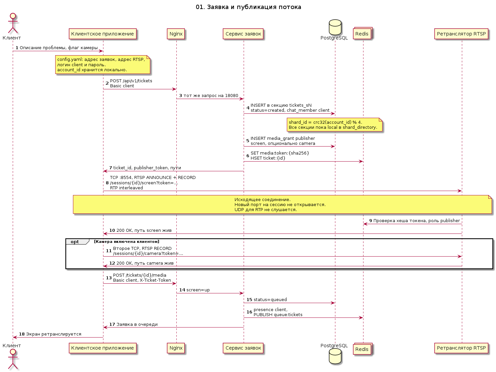
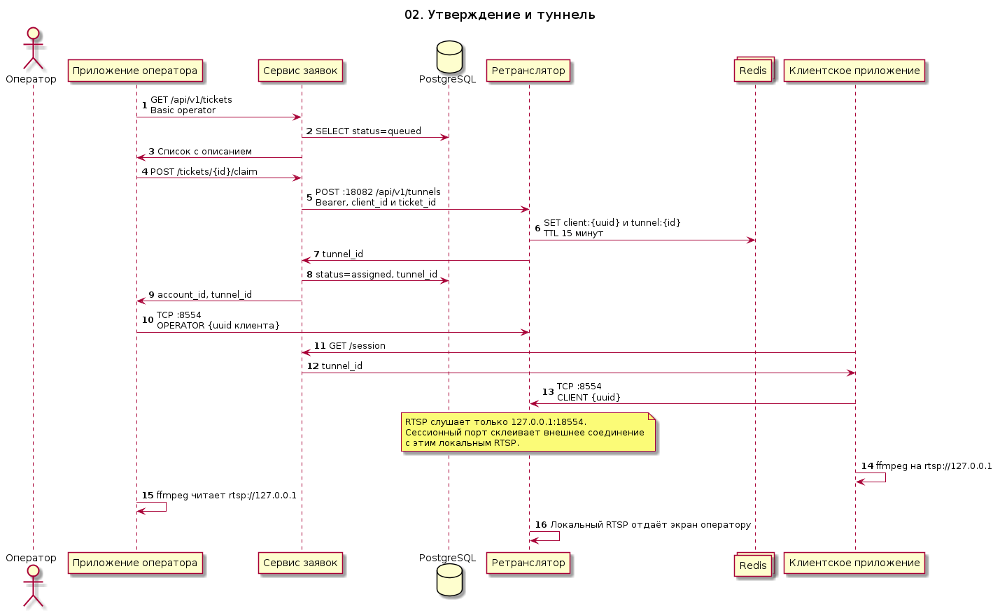
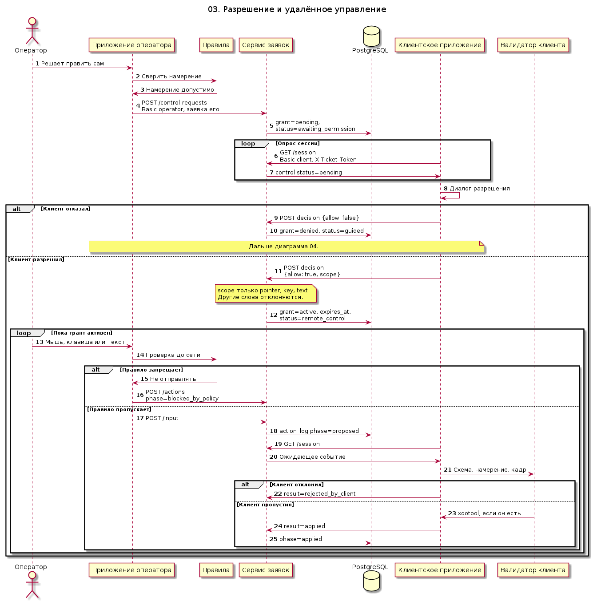
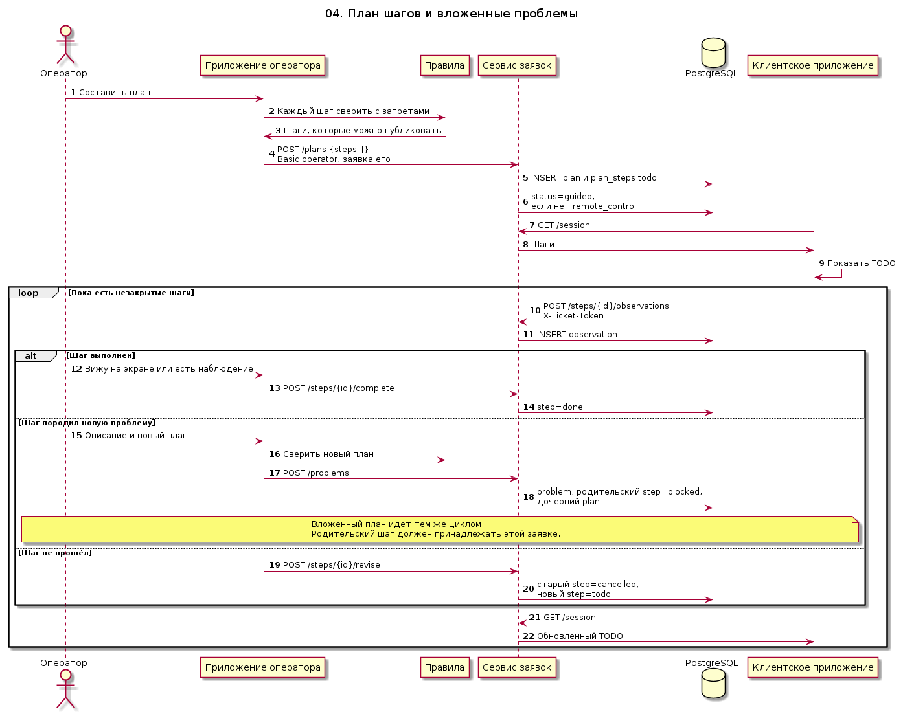
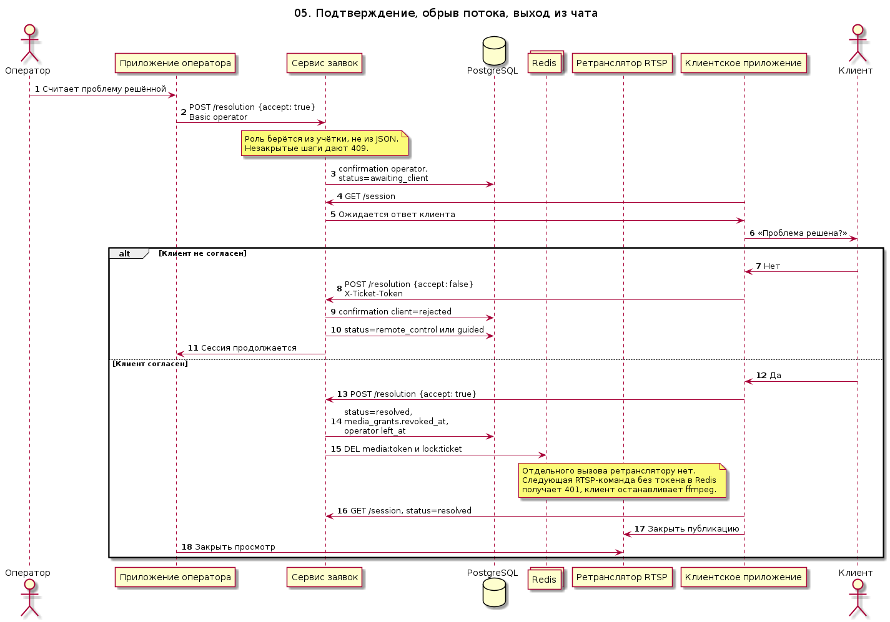
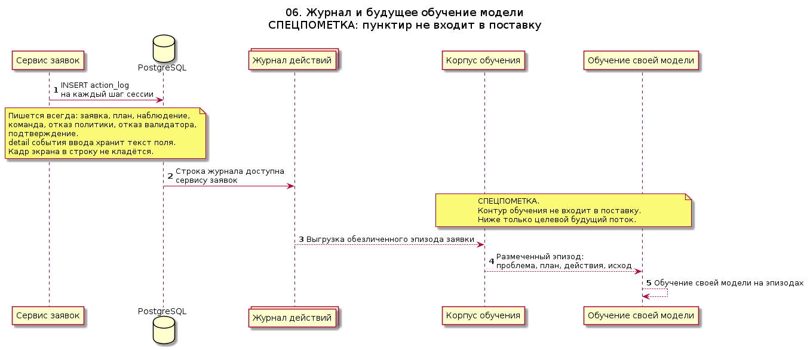
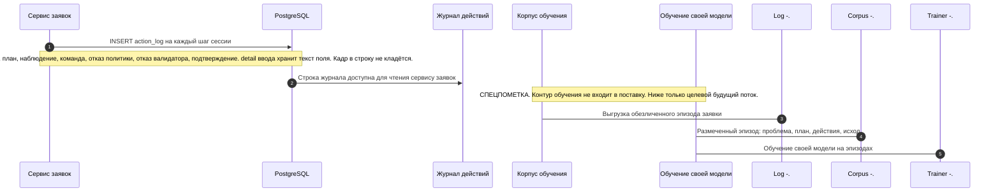
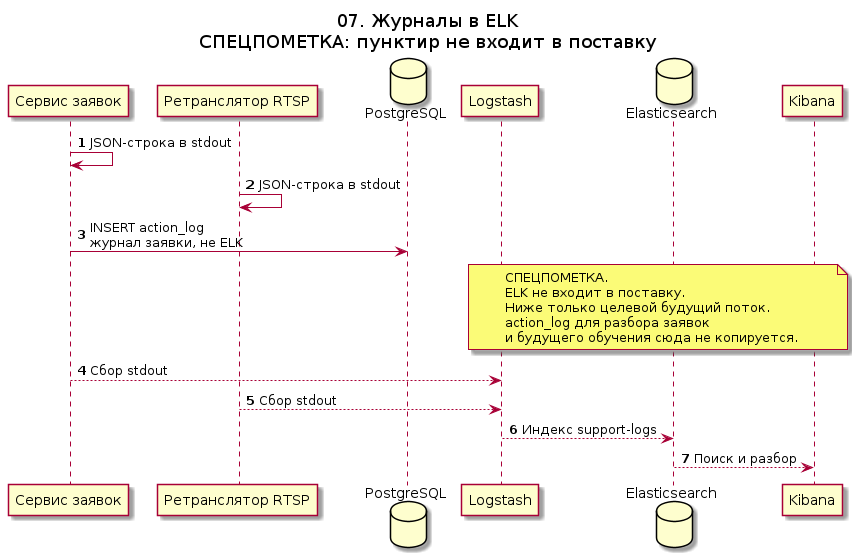
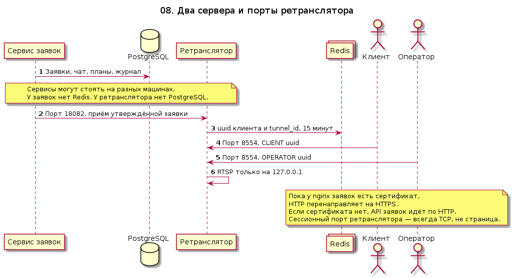
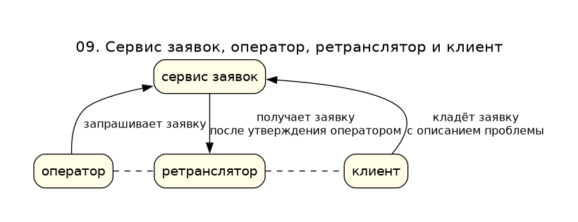

# Архитектура

Сплошная линия на диаграммах — поведение текущей поставки. Пунктир — контур, которого в поставке нет. Картинки и исходники лежат в [uml](uml), рядом с ними отдельных текстов нет.

| Диаграмма | Картинка | Исходник |
| --- | --- | --- |
| [01. Заявка](#d01) | [png](uml/01-ticket-and-publish.png) | [puml](uml/01-ticket-and-publish.puml) |
| [02. Утверждение и туннель](#d02) | [png](uml/02-operator-connect.png) | [puml](uml/02-operator-connect.puml) |
| [03. Удалённое управление](#d03) | [png](uml/03-remote-control.png) | [puml](uml/03-remote-control.puml) |
| [04. План шагов](#d04) | [png](uml/04-step-plan.png) | [puml](uml/04-step-plan.puml) |
| [05. Завершение](#d05) | [png](uml/05-session-end.png) | [puml](uml/05-session-end.puml) |
| [06. Журнал обучения](#d06) | [png](uml/06-training-journal.png) | [puml](uml/06-training-journal.puml) |
| [07. Журналы в ELK](#d07) | [png](uml/07-log-shipping.png) | [puml](uml/07-log-shipping.puml) |
| [08. Два сервера и порты](#d08) | [png](uml/08-ingress.png) | [puml](uml/08-ingress.puml) |
| [09. Треугольник](#d09) | [png](uml/09-triangle.png) | [puml](uml/09-triangle.puml) |

Сервис заявок и ретранслятор — разные узлы. Диаграмма 08 показывает, у кого Postgres, у кого Redis и какие порты открыты. Диаграмма 09 — тот же треугольник одной картинкой.

| Участник | Папка |
| --- | --- |
| Клиентское приложение | [client-app](../client-app/README.md) |
| Приложение оператора | [operator-app](../operator-app/README.md) |
| Nginx и сертификаты | [certs](../certs/letsencrypt.sh), диаграмма [08](#d08) |
| Сервис заявок | [ticket-service](../ticket-service/README.md) |
| Ретранслятор | [relay-service](../relay-service/README.md) |
| PostgreSQL заявок | [postgres-redis](../postgres-redis/README.md) |
| ELK | пунктир, диаграмма [07](#d07) |
| Правила и валидаторы | [safety-policy](../safety-policy/README.md) |
| Журнал обучения | [training-log](../training-log/README.md) |

Обязательные документы трёх частей команды — в [PARTS.md](PARTS.md).

## 01. Заявка с описанием проблемы

Клиент не открывает входящий порт. Приложение читает адрес сервиса заявок из `config.yaml` и создаёт заявку: uuid клиента, текст проблемы и флаг камеры. Сервис заявок пишет строку в PostgreSQL, в секцию `tickets_sN`, где `shard_id = crc32(account_id) % 4`. Статус сразу `queued`. Отдельного Redis у заявок нет.

Сырой `ticket_token` возвращается один раз. Дальше клиент передаёт его в `X-Ticket-Token`. Экран на этом шаге не публикуется: туннель появится после утверждения оператором.

## 02. Утверждение и туннель

Оператор забирает заявку из PostgreSQL. Сервис заявок после этого вызывает порт приёма ретранслятора `18082` и передаёт uuid клиента и id заявки. Ретранслятор кладёт в свой Redis uuid клиента и внутренний `tunnel_id` на 15 минут. Заявка в работе живёт в этих пределах, поэтому база ретранслятору не нужна.

Дальше и клиент, и оператор подключаются к одному сессионному порту `8554`. Первая строка — `CLIENT <uuid>` или `OPERATOR <uuid>`. RTSP наружу не опубликован: внутри ретранслятора он слушает только `127.0.0.1:18554`. Приложения на своих машинах принимают ffmpeg на localhost и прокидывают этот поток в сессионный порт, чтобы кадр не был открыт всему миру.

## 03. Разрешение и удалённое управление

Пока клиент не ответил «да», сервис не принимает команды ввода. Запрос управления пишет грант `pending`. Клиент видит его в очередном `GET /session`, а не через толчок сервера. Согласие ставит `remote_control` и scope из слов `pointer`, `key`, `text`. Отказ ставит `guided` и ведёт к плану шагов.

Человек и модель проходят один валидатор в приложении оператора до отправки и второй на клиенте до `xdotool`. Запрещённое намерение пишется как `blocked_by_policy` и на клиента не уходит. Клиент отвечает `applied` или `rejected_by_client`. Запрос оператора требует, чтобы заявка была закреплена за ним. Ответ клиента требует `X-Ticket-Token` этой заявки.

## 04. План шагов и вложенные проблемы

Сценарий начинается, когда клиент не дал управление, и продолжается, если по ходу работы появилась новая проблема. Оператор публикует план. Если заявка уже в `remote_control`, этот статус сохраняется. Иначе он становится `guided`.

Клиент видит шаги опросом сессии. Отметка «выполнено» требует наблюдение клиента или пометку оператора «вижу на экране». Дочерняя проблема блокирует родительский шаг только если этот шаг принадлежит той же заявке. Шаг, который правила не пропускают, до сервиса не доходит: сервис тоже режет запрещённый текст.

## 05. Подтверждение и снятие туннеля

Сессия не заканчивается, пока и оператор, и клиент не подтвердили, что проблема решена. Роль подтверждения берётся из учётки. Незакрытые шаги `todo` и `blocked` дают отказ.

Отказ клиента возвращает `remote_control`, если грант ещё активен, иначе `guided`. Согласие обоих ставит `resolved`. Сервис заявок вызывает `DELETE /api/v1/tunnels/{ticket}` на порту приёма ретранслятора, тот удаляет uuid клиента и `tunnel_id` из Redis. Клиент останавливает ffmpeg и локальный мост.

## 06. Журнал и будущее обучение модели

СПЕЦПОМЕТКА. Пунктирные стрелки — контур, которого нет в текущей поставке. Сейчас продукт только пишет журнал. Сбор корпуса, разметка и обучение своей модели сюда не входят и на диаграмме не считаются реализованным потоком.

Журнал нужен, чтобы позже учить модель на реальных разборах: какая была проблема, какой план предложили, что сделали, что увидел клиент, чем всё закончилось. В журнал попадают и отказы валидаторов: модели полезно видеть, какие действия правила не пропустили.

Пока пунктир не реализован, модель в кресле оператора, если её подключат, работает по правилам из [safety-policy](../safety-policy/README.md) и не дообучается на журнале этой сессии.

## 07. Журналы в ELK

СПЕЦПОМЕТКА. Пунктир — контур, которого в поставке нет. Сервисы уже пишут JSON в stdout. Logstash, Elasticsearch и Kibana не разворачиваются.

`action_log` в PostgreSQL сюда не входит: это журнал заявок для разбора и будущего обучения, а не операционный индекс.

## 08. Два сервера и порты ретранслятора

Сервис заявок и ретранслятор могут стоять на разных машинах. У заявок PostgreSQL. У ретранслятора только Redis: заявка в работе хранится 15 минут.

У ретранслятора открыты два порта. `18082` принимает утверждённую заявку от сервиса заявок и пишет в Redis uuid клиента и внутренний id туннеля. `8554` — порт, к которому подключается клиент со своим uuid и оператор, который этого клиента обслуживает. RTSP остаётся на `127.0.0.1` самого ретранслятора.

Nginx относится к сервису заявок. Пока сертификат есть, HTTP только перенаправляет на HTTPS. Если сертификата нет, API заявок идёт по `http://127.0.0.1:8080`. Сессионный порт — это не страница.

## 09. Сервис заявок, оператор, ретранслятор и клиент

Клиент кладёт в сервис заявок описание проблемы. Оператор запрашивает заявку у того же сервиса. После утверждения сервис заявок отдаёт заявку ретранслятору. Оператор и клиент сходятся уже на ретрансляторе: пунктир — сессионный порт, не страница и не открытый RTSP.

