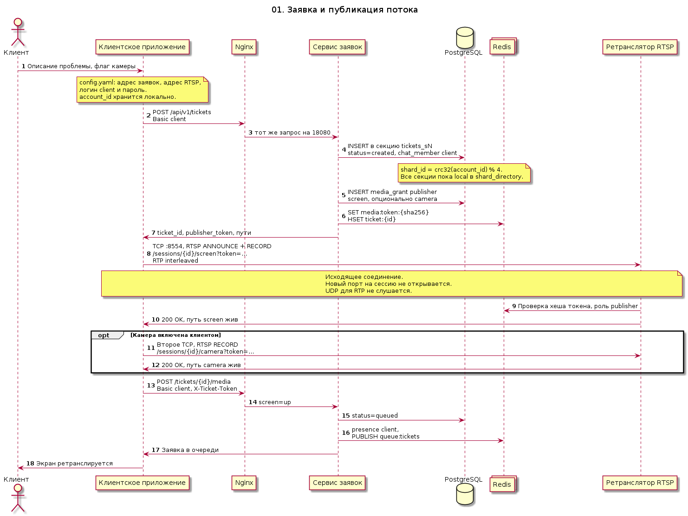

# 01. Заявка и публикация потока

Клиент не открывает входящий порт. Приложение читает адрес заявок, адрес RTSP и логин `client` из `config.yaml`, само создаёт заявку и публикует экран. Пока у nginx есть сертификат, этот адрес — `https://127.0.0.1:443`: HTTP на порту `8080` только перенаправляет туда. Камера — второе исходящее TCP на тот же порт `8554`, отдельный путь `/sessions/{id}/camera`.

Заявка пишется в секцию `tickets_sN`. Номер секции — `crc32(account_id) % 4`. Каталог `shard_directory` пока держит все секции на одном узле. Создание требует Basic-аутентификацию клиента. Постановка в очередь требует ещё заголовок `X-Ticket-Token` с токеном издателя. В Redis кладётся хеш токена, не сам токен. Событие `queue:tickets` публикуется, когда экран уже в статусе `up`.

Исходник: [01-ticket-and-publish.puml](01-ticket-and-publish.puml)

