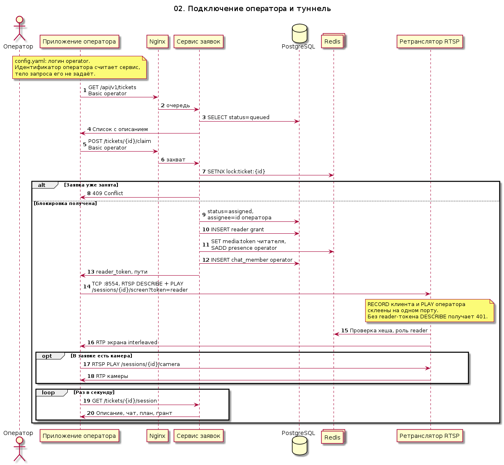

# 02. Подключение оператора и туннель

Оператор подключается к ретранслятору исходящим соединением. Издатель и зритель сидят на одном порту `8554`, сервер склеивает их по пути сессии. Отдельный порт и UDP для RTP не открываются.

Очередь — `GET /api/v1/tickets` с логином `operator`. Идентификатор оператора сервис считает из этого логина, тело `claim` его не задаёт. Повторный захват получает 409. После захвата статус `assigned`, в Redis появляется токен читателя. Чат и состояние сессии приложение забирает опросом `GET /tickets/{id}/session` раз в секунду, сокета в прототипе нет.

Оператор на диаграмме — роль. Её исполняет человек или языковая модель через то же приложение и тот же API.

Исходник: [02-operator-connect.puml](02-operator-connect.puml)

