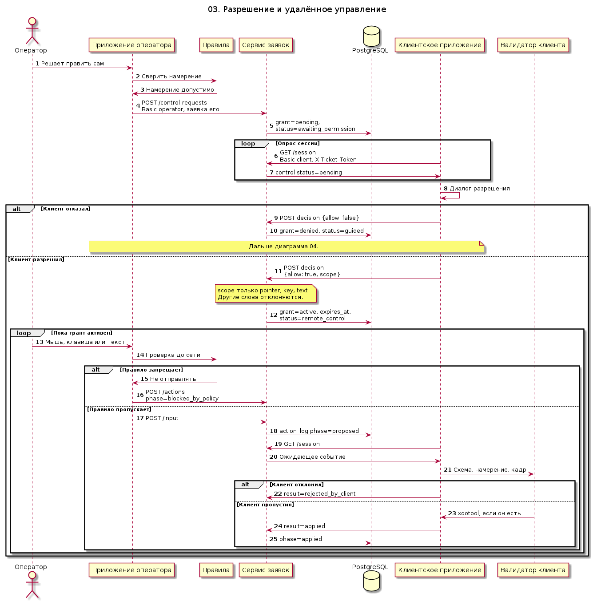

# 03. Разрешение и удалённое управление

Пока клиент не ответил «да», сервис не принимает команды ввода. Запрос управления пишет грант `pending`. Клиент видит его в очередном `GET /session`, а не через толчок сервера. Согласие ставит `remote_control` и scope из слов `pointer`, `key`, `text`. Отказ ставит `guided` и ведёт к плану шагов.

Человек и модель проходят один валидатор в приложении оператора до отправки и второй на клиенте до `xdotool`. Запрещённое намерение пишется как `blocked_by_policy` и на клиента не уходит. Клиент отвечает `applied` или `rejected_by_client`. Запрос оператора требует, чтобы заявка была закреплена за ним. Ответ клиента требует токен издателя.

Исходник: [03-remote-control.puml](03-remote-control.puml)

