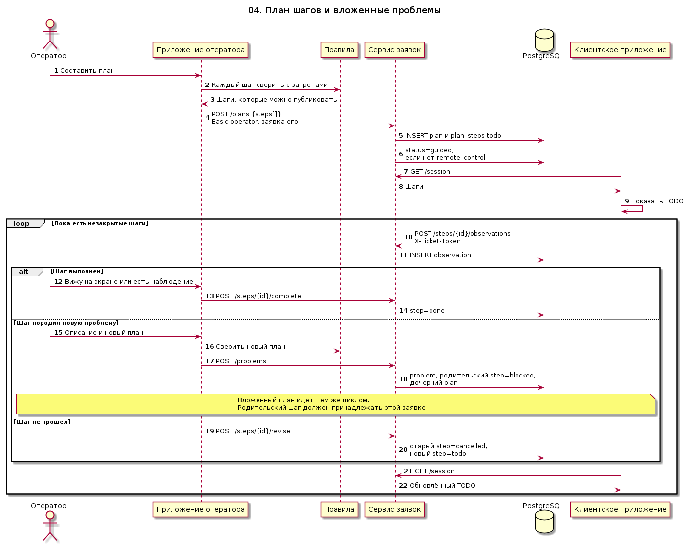

# 04. План шагов и вложенные проблемы

Сценарий начинается, когда клиент не дал управление, и продолжается, если по ходу работы появилась новая проблема. Оператор публикует план. Если заявка уже в `remote_control`, этот статус сохраняется. Иначе он становится `guided`.

Клиент видит шаги опросом сессии. Отметка «выполнено» требует наблюдение клиента или пометку оператора «вижу на экране». Дочерняя проблема блокирует родительский шаг только если этот шаг принадлежит той же заявке. Шаг, который правила не пропускают, до сервиса не доходит: сервис тоже режет запрещённый текст.

Исходник: [04-step-plan.puml](04-step-plan.puml)

