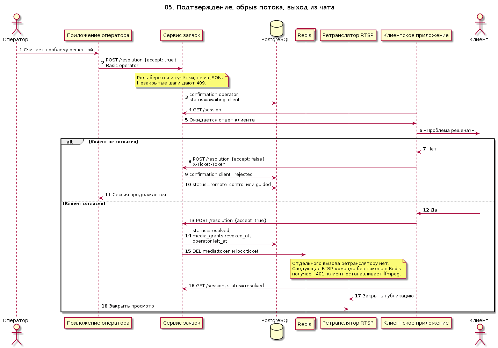

# 05. Подтверждение, обрыв потока, выход из чата

Сессия не заканчивается, пока и оператор, и клиент не подтвердили, что проблема решена. Роль подтверждения берётся из учётки. Незакрытые шаги `todo` и `blocked` дают отказ.

Отказ клиента возвращает `remote_control`, если грант ещё активен, иначе `guided`. Согласие обоих ставит `resolved`, помечает медиагранты отозванными, удаляет токены и блокировку в Redis и отмечает выход оператора из чата. Отдельного вызова ретранслятору нет: следующая RTSP-команда без токена получает 401, а клиент, увидев `resolved`, останавливает публикацию.

Исходник: [05-session-end.puml](05-session-end.puml)

