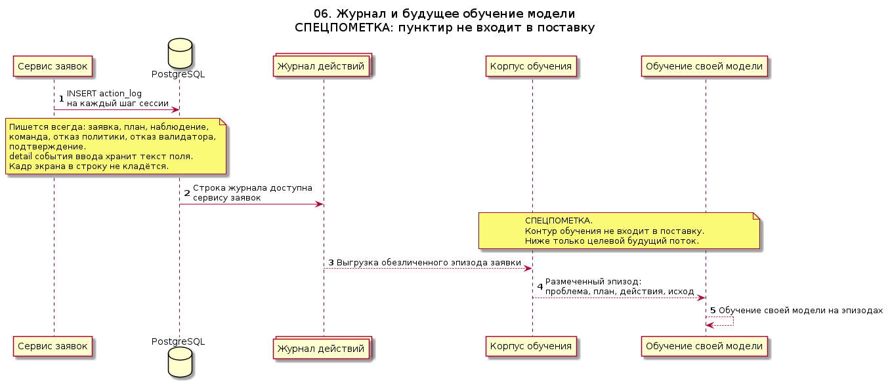
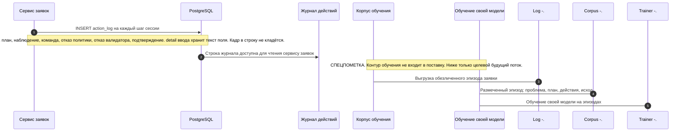

# 06. Журнал и будущее обучение модели

СПЕЦПОМЕТКА. Пунктирные стрелки — контур, которого нет в текущей поставке. Сейчас продукт только пишет журнал. Сбор корпуса, разметка и обучение своей модели сюда не входят и на диаграмме не считаются реализованным потоком.

Журнал нужен, чтобы позже учить модель на реальных разборах: какая была проблема, какой план предложили, что сделали, что увидел клиент, чем всё закончилось. В журнал попадают и отказы валидаторов: модели полезно видеть, какие действия правила не пропустили.

Исходник: [06-training-journal.puml](06-training-journal.puml)

Пока пунктир не реализован, модель в кресле оператора, если её подключат, работает по правилам из [safety-policy](../../safety-policy/README.md) и не дообучается на журнале этой сессии.
