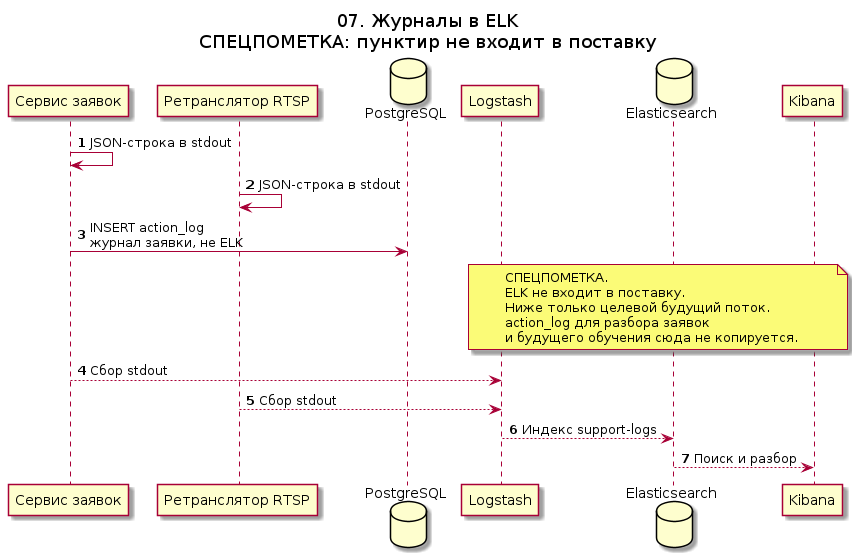

# 07. Журналы в ELK

СПЕЦПОМЕТКА. Пунктир — контур, которого в поставке нет. Сервисы уже пишут JSON в stdout. Logstash, Elasticsearch и Kibana не разворачиваются.

`action_log` в PostgreSQL сюда не входит: это журнал заявок для разбора и будущего обучения, а не операционный индекс.

Исходник: [07-log-shipping.puml](07-log-shipping.puml)

