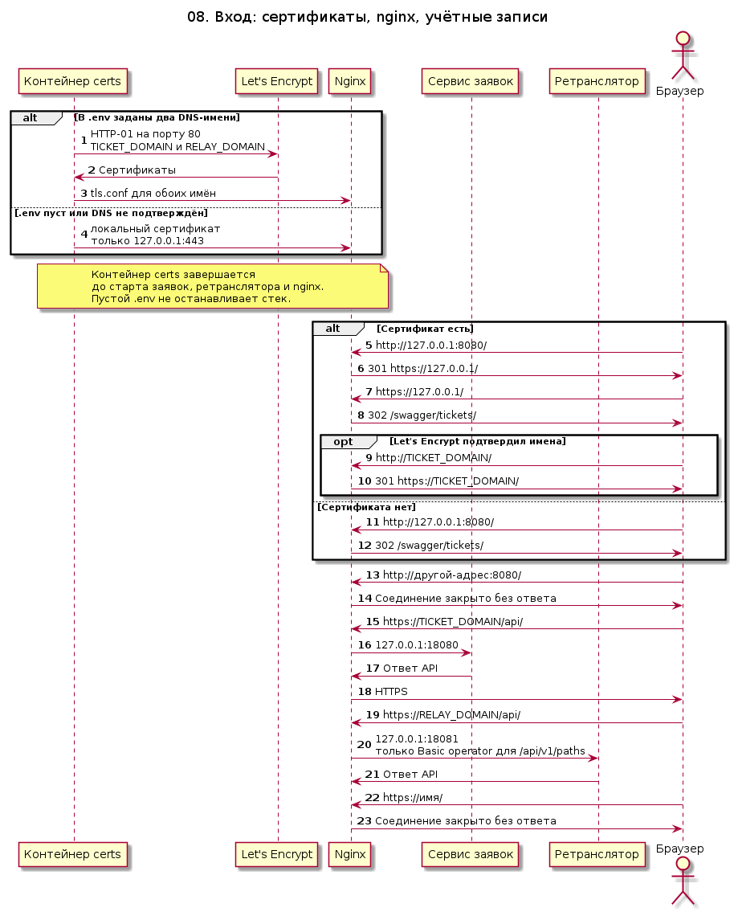

# 08. Вход: сертификаты, nginx, учётные записи

Контейнер `certs` отрабатывает до старта сервиса заявок, ретранслятора и nginx и пишет `http.conf` вместе с `tls.conf`. Если в `.env` заданы почта и два разных DNS-имени, он выпускает сертификаты Let's Encrypt по HTTP-01 на порту 80. Если `.env` нет или центр сертификации не подтвердил имя, пишется локальный сертификат только на `127.0.0.1:443`. Если не вышел даже он, сертификата нет.

Пока сертификат есть, nginx не отдаёт API по HTTP. `http://127.0.0.1:8080` отвечает `301` на `https://127.0.0.1`. После успешного Let's Encrypt порт 80 для этих двух имён тоже отвечает `301` на тот же путь по HTTPS. С другого адреса порт `8080` закрывается без ответа. `https://127.0.0.1/` открывает Swagger. `https://TICKET_DOMAIN` проксирует `/api/` и `/health` на сервис заявок, `https://RELAY_DOMAIN` — на ретранслятор. Пустой путь публичного HTTPS закрывается без ответа, Swagger с публичного имени не отдаётся.

Если сертификата нет, `http://127.0.0.1:8080/` сам открывает Swagger и проксирует API.

HTTP ретранслятора `GET /api/v1/paths` принимает только логин `operator`. RTSP по-прежнему пускает издателя и зрителя по токену заявки.

Исходник: [08-ingress.puml](08-ingress.puml)

