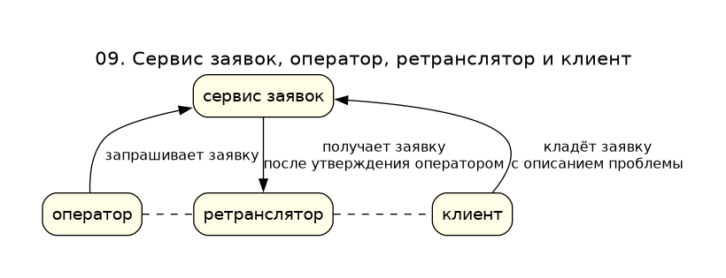

# 09. Сервис заявок, оператор, ретранслятор и клиент

Клиент кладёт в сервис заявок описание проблемы. Оператор запрашивает заявку у того же сервиса. После утверждения сервис заявок отдаёт заявку ретранслятору. Оператор и клиент сходятся уже на ретрансляторе: пунктир — сессионный порт, не страница и не открытый RTSP.

Исходник: [09-triangle.puml](09-triangle.puml)

