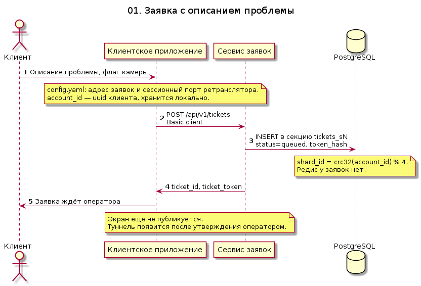
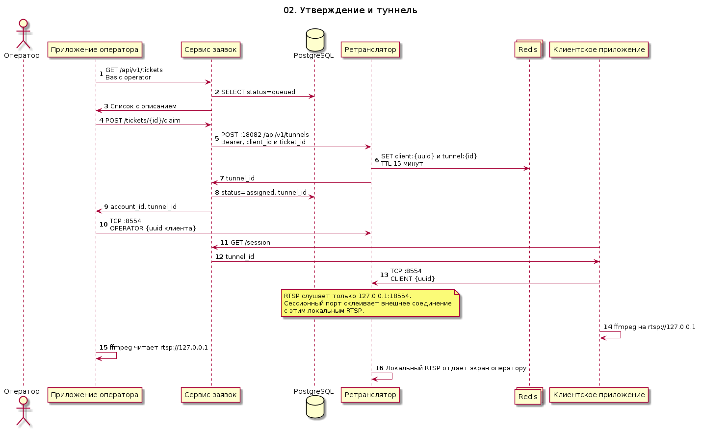
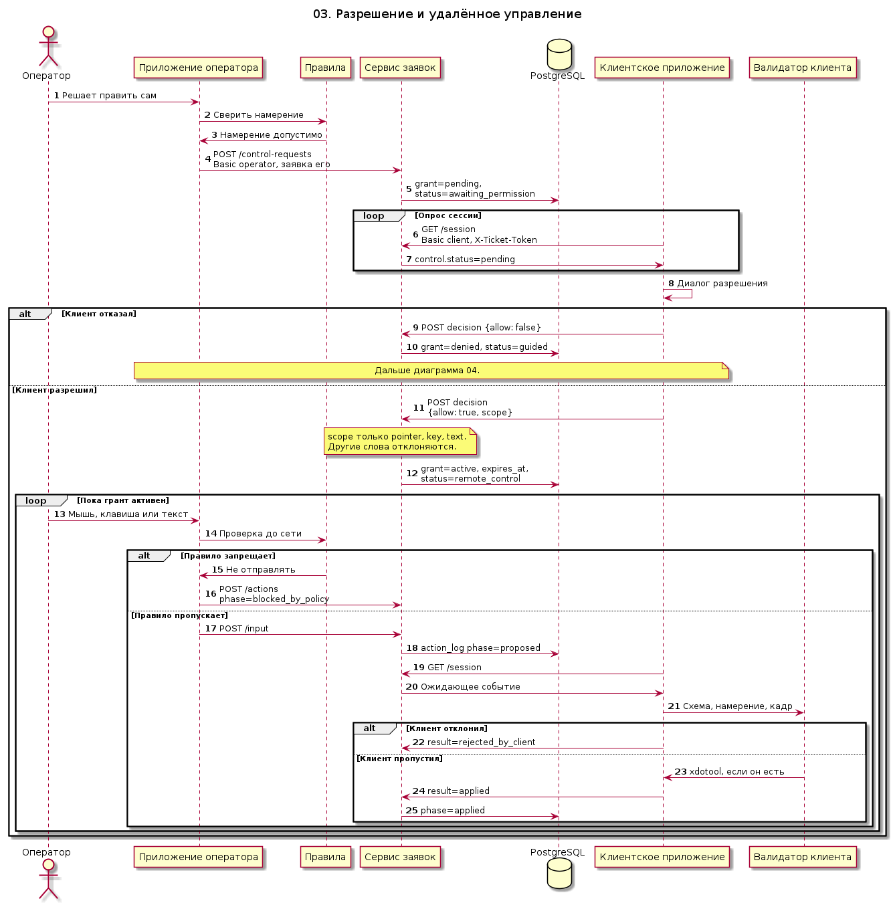
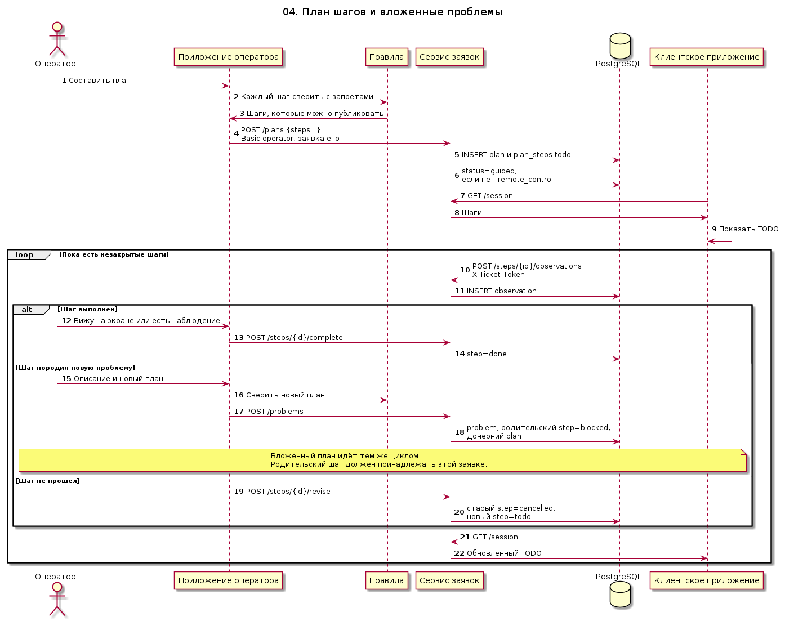
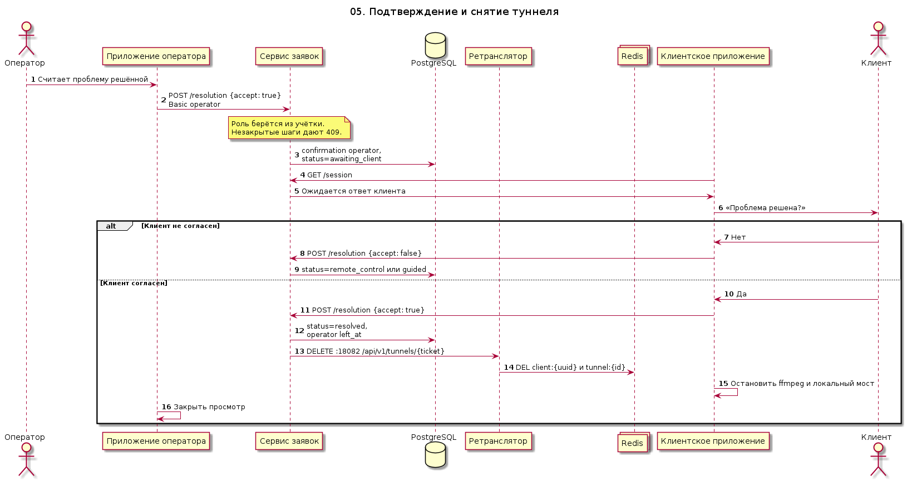
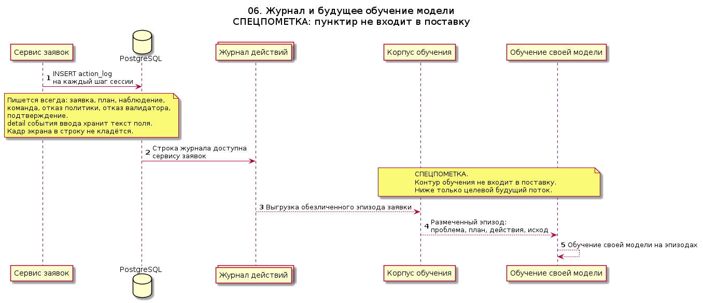
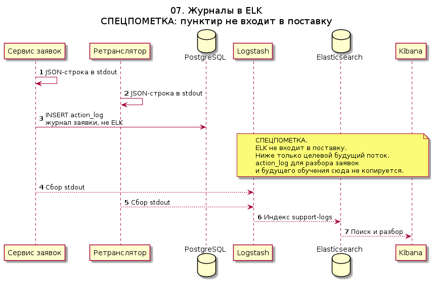
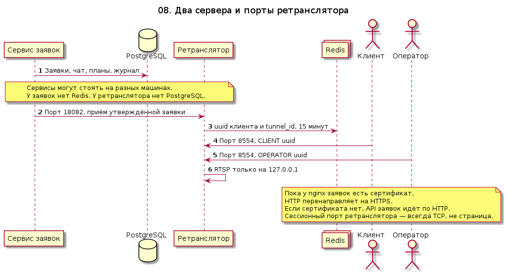
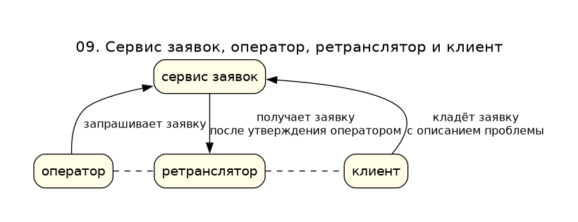

# Sequence-диаграммы

Каждая диаграмма — UML sequence в PlantUML: исходник `.puml` и картинка `.png`. Сплошная линия — поведение текущей поставки. Пунктир — контур, которого в поставке нет.

| Диаграмма | Картинка | Исходник |
| --- | --- | --- |
| 01. Заявка | [png](01-ticket-and-publish.png) | [puml](01-ticket-and-publish.puml) |
| 02. Утверждение и туннель | [png](02-operator-connect.png) | [puml](02-operator-connect.puml) |
| 03. Удалённое управление | [png](03-remote-control.png) | [puml](03-remote-control.puml) |
| 04. План шагов | [png](04-step-plan.png) | [puml](04-step-plan.puml) |
| 05. Завершение | [png](05-session-end.png) | [puml](05-session-end.puml) |
| 06. Журнал обучения | [png](06-training-journal.png) | [puml](06-training-journal.puml) |
| 07. Журналы в ELK | [png](07-log-shipping.png) | [puml](07-log-shipping.puml) |
| 08. Два сервера и порты | [png](08-ingress.png) | [puml](08-ingress.puml) |
| 09. Треугольник | [png](09-triangle.png) | [puml](09-triangle.puml) |

Сервис заявок и ретранслятор — разные узлы. Диаграмма 08 показывает, у кого Postgres, у кого Redis и какие порты открыты.

| Участник | Папка |
| --- | --- |
| Клиентское приложение | [client-app](../../client-app/README.md) |
| Приложение оператора | [operator-app](../../operator-app/README.md) |
| Nginx и сертификаты | [certs](../../certs/letsencrypt.sh), диаграмма [08](08-ingress.md) |
| Сервис заявок | [ticket-service](../../ticket-service/README.md) |
| Ретранслятор | [relay-service](../../relay-service/README.md) |
| PostgreSQL заявок | [postgres-redis](../../postgres-redis/README.md) |
| ELK | пунктир, диаграмма [07](07-log-shipping.md) |
| Правила и валидаторы | [safety-policy](../../safety-policy/README.md) |
| Журнал обучения | [training-log](../../training-log/README.md) |
